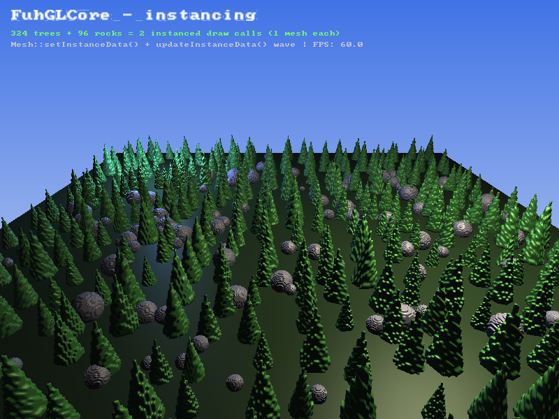

# 28 — Instancing: hundreds of bodies, one draw call per mesh

**Goal:** render many copies of the same geometry with a single draw call —
trees, rocks, particles, a crowd — by uploading per-instance model matrices once
and letting the GPU fetch them per instance.



## How it works

`render::Mesh` gained an optional **instance buffer**: a divisor-1 `mat4` vertex
attribute at locations 4..7 (one `vec4` column per attribute, 64 bytes stride,
column-major `math::Mat4`):

```cpp
fuhgl::render::Mesh treeMesh = tree->buildMesh(24, {1,1,1});   // build once

std::vector<fuhgl::math::Mat4> models = {
    fuhgl::math::translate({-2.f, 0.f, 0.f}) * fuhgl::math::scale({1,1,1}),
    fuhgl::math::translate({ 2.f, 0.f, 1.f}) * fuhgl::math::scale({1.3f,1.3f,1.3f}),
    // ...
};
treeMesh.setInstanceData(models.data(), (int)models.size());   // upload once
// per frame, if the instances move:
treeMesh.updateInstanceData(models.data(), (int)models.size()); // glBufferSubData
// and to go back to a single draw:
treeMesh.clearInstanceData();
```

`Mesh::draw()` then issues `glDrawElementsInstanced` / `glDrawArraysInstanced`
automatically when `instanceCount() > 0` — **the render loops don't change at all**:

```cpp
scene.items.push_back({&treeMesh, &treeMat, fuhgl::math::Mat4{}});  // 324 instances, 1 draw
pipeline.render(scene);
```

The built-in pipeline shaders (forward, deferred G-buffer, shadow depth pass) declare
`layout(location = 4) in mat4 aInstanceModel;` and combine it when the new
`uInstanced` uniform is 1 (set automatically from `item.mesh->instanceCount()`):

```glsl
mat4 model = (uInstanced == 1) ? (uModel * aInstanceModel) : uModel;
```

So the item's `model` acts as a group transform and each instance matrix places one
copy — instanced meshes also cast shadows correctly (the depth pass is instanced too).
When a mesh has no instance buffer, attribute 4 is disabled and the shader reads the
generic default — but `uInstanced == 0` selects `uModel`, so plain draws are unaffected
(no extra program variants needed).

## Example

`examples/instancing` renders an 18×18 grid of cones (324 trees) plus 96 scattered
spheres (rocks) — **2 draw calls for 420 bodies** — through the deferred renderer,
with a wave animation re-uploaded every frame via `updateInstanceData()` and a
TextRenderer HUD:

```
FUHGL_BACKEND=surfaceless ./build-egl/examples/instancing --screenshot docs/images/tutorial-instancing.png
```

Tests: `tests/gl_smoke_instancing.cpp` (headless: one box mesh with 3 instance
matrices lights three probe pixels; `updateInstanceData()` moves them — the center
probe goes sky; `clearInstanceData()` restores the single draw; GL-error checked;
skips without GL ≥ 3.3).
